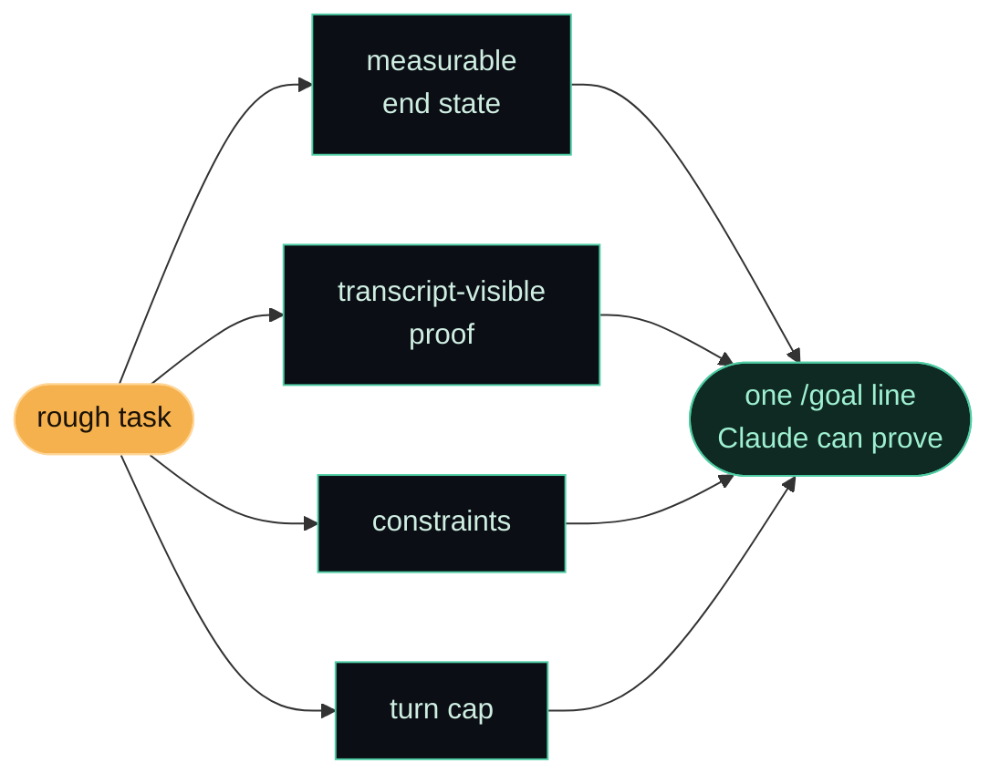

<p align="center">
  
</p>

<p align="center">
  <a href="https://github.com/edcadet10/write-goal/actions/workflows/ci.yml"></a>
  <a href="LICENSE"></a>
  <a href="https://code.claude.com/docs/en/skills"></a>
  
  
  <a href="CONTRIBUTING.md"></a>
</p>

<p align="center"><b>Hand it a rough task. Get back one <code>/goal</code> line that Claude can actually prove it finished.</b></p>

---

## how it came to life

I was poking at Claude Code's `/goal` command, trying to work out its switches, and somewhere in there it clicked that I'd been ignoring a whole built-in loop. `/goal <condition>` keeps Claude working across turns until the condition is true. I'd been babysitting long tasks by hand the entire time.

Then I hit the catch. A small fast model (Haiku, by default) is the one deciding when you're done, and it can't run commands or open files. It only sees what Claude has already printed into the chat. So "loop until the tests pass" is worthless if Claude never prints the test output, and "until the code is clean" never terminates because nothing makes "clean" true or false. A good goal has to carry its own proof.

I didn't want to solve that puzzle by hand every time I started a loop. So I asked for a skill that writes the goal for me: give it a rough task, hand me back one line I can paste. That's `write-goal`. Funny enough, every task in the session where it was born was itself set with `/goal` — including the one that built this.

It's the second skill in my Claude Code arsenal, after [disconfirm](https://github.com/edcadet10/disconfirm).

## what it does

You run it with a rough task:

```text
/write-goal migrate the auth module to the new API
```

It hands back one `/goal` line with four things built in:

- a measurable end state, a real signal like an exit code or a file count, never "works" or "done"
- a proof that shows up in the transcript, a specific command whose output Claude prints
- the constraints to hold, what must not change on the way there
- a turn cap, so a stuck loop stops and reports instead of running forever

If your task is too vague to have a finish line, it asks you exactly one question and then gets on with it. One question, never a quiz.

## how it builds the goal



## install

From the repo root:

```bash
./install.sh
```

It drops the skill into `~/.claude/skills/` and tells you how to call it. Or do it by hand:

```bash
cp -r skills/write-goal ~/.claude/skills/
```

No hook, no settings to edit. It runs when you call `/write-goal`, and not a moment otherwise.

## a real example

Rough task in:

```text
/write-goal utils.js is too big, split it
```

`/goal` line out:

```text
/goal src/utils.js is split into focused modules each under 200 lines with all imports updated, proven in the transcript by `npm run build` and `npm test` both exiting 0 with the same passing-test count as before. Do not change any exported function signature. Stop after 25 turns and report what remains.
```

Read it back and you can see the four ingredients: the end state (modules under 200 lines, imports updated), the proof Claude has to print (`build` and `test` both exit 0, test count unchanged), the constraint (no signature changes), and the cap (25 turns, then report).

## the one rule it never breaks

The proof has to be something Claude prints, not something the evaluator goes and checks. That single fact is what makes goals terminate instead of spinning. Every line the skill writes is built around it.

## contribute

Contributions are welcome. Read the [guide](CONTRIBUTING.md), open an [issue](https://github.com/edcadet10/write-goal/issues/new/choose), or discuss broad changes in [Discussions](https://github.com/edcadet10/write-goal/discussions). Run `./scripts/check.sh` before opening a PR.

## part of my arsenal

One of the skills I lean on daily in Claude Code, published so other people can use it too. If it saves you from one loop that ran twelve turns past done because the goal couldn't tell it was finished, it earned its place.

## license

MIT. Fork it, tighten it, make it yours. See [LICENSE](LICENSE).
