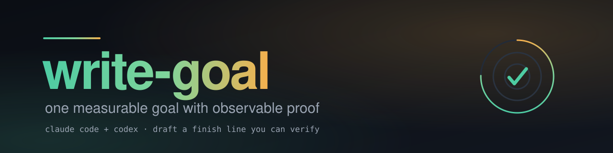

<p align="center">
  
</p>

<p align="center">
  <a href="https://github.com/edcadet10/write-goal/actions/workflows/ci.yml"></a>
  <a href="LICENSE"></a>
  
</p>

<p align="center"><b>AI-agnostic goal writing: one measurable goal with observable proof.</b><br>Use the shared instructions with your chosen assistant. Native integrations are optional.</p>

## what it does

Give Write Goal a rough task. It drafts one completion condition with four parts:

- the measurable result;
- actual evidence the assistant must surface;
- the user's constraints and approval gates;
- a stopping boundary that does not get confused with success.

The shared [skill instructions](skills/write-goal/SKILL.md) are provider-neutral
text. They do not require an account with a particular AI vendor, a specific
model, or a native goal command. The assistant you choose supplies its own model
access and capabilities.

## use with your chosen assistant

1. Supply the shared instructions as prompt context, or load the entire skill
   folder if your application supports Agent Skills.
2. Describe the desired result and any constraints, deadline, or turn limit.
3. Receive one plain completion condition. Replace any unknown-check placeholder
   before asking the assistant to act on it.

The [optional application adapters](skills/write-goal/references/hosts.md)
provide native formatting when you want it. Their requirements apply only to
the selected application; the model provider does not select an adapter.

## optional native integrations

The following integrations are tested conveniences. The shared prompt workflow
above works without installing either client. These are application names, not
requirements to use a particular model provider.

### Claude Code

In your terminal:

```bash
claude plugin install write-goal --marketplace edcadet10/write-goal
```

Start a new session and invoke `/write-goal:write-goal <rough task>`.
See [Claude's plugin installation guide](https://code.claude.com/docs/en/plugins/install).

### Codex

In your terminal:

```bash
codex plugin marketplace add edcadet10/write-goal
codex plugin add write-goal@write-goal
```

Start a new session and select the plugin's Write Goal skill. See
[OpenAI's plugin documentation](https://developers.openai.com/plugins/build/plugins).
The catalog is hosted in this GitHub repository and is separate from a public
plugin-directory listing. Native installation was tested with Claude Code
2.1.316 and Codex CLI 0.166.0.

## optional standalone installation

With Python 3.10+ and Git:

```bash
git clone https://github.com/edcadet10/write-goal.git
cd write-goal
python install.py --target claude
# Or:
python install.py --target codex
```

Use `python3` if that is your Python command. `./install.sh` forwards the same
options. No third-party Python packages are required.

| Destination | Standalone invocation | Default output |
| --- | --- | --- |
| Claude Code | `/write-goal <task>` | Native `/goal <condition>` line |
| Codex | `$write-goal <task>` | Plain completion condition |
| Other assistant | Supply the skill folder or paste its instructions as context | Plain completion condition |

Choose either plugin or standalone installation to avoid duplicate entries.
For manual installation without Python, download the standalone skill ZIP from
[Releases](https://github.com/edcadet10/write-goal/releases/latest) and keep the
entire `write-goal/` folder, including its adapter reference.

Claude's installer defaults to `~/.claude/skills/` and respects
`CLAUDE_CONFIG_DIR`. Codex defaults to `~/.agents/skills/`, or `$CODEX_HOME/skills/`
when set. Other applications use their own skill-loading paths. To choose a
skills parent directory explicitly:

```bash
python install.py --target codex --dest "/path with spaces/skills"
```

Identical reinstallations make no changes. Review local edits before replacing
a different installed copy with `--force`. The installer replaces this skill's
folder and leaves neighboring skills alone.

## drafting and activation

Drafting executes no task or verification command. It activates or replaces no
goal without an explicit request. Unknown applications acquire no assumed
slash commands, tool API, permissions, hooks, or scheduler. The skill does not
continue after a session ends or guarantee outcomes controlled by other people.

Application-specific activation rules are documented in the optional
[adapter reference](skills/write-goal/references/hosts.md). Every application
retains its own capabilities and permissions. A draft does not create tools,
grant access, or start a background worker.

## testing and contributing

```bash
python scripts/check.py
```

CI runs the portable suite on Windows, macOS, and Linux with Python 3.10 and
3.12. Real native installation checks use isolated host profiles and compare
the complete installed skill with source. Behavioral cases cover both native
adapters, a generic assistant, explicit plain text, and model/application
distinctions. See the [evaluation guide](evals/README.md) and
[contribution guide](CONTRIBUTING.md) for commands and evidence limitations.

Code and maintained source are hosted on GitHub. Report a reproducible issue
with fictional data through [GitHub issues](https://github.com/edcadet10/write-goal/issues).
See [SECURITY.md](SECURITY.md) for private vulnerability reporting.

## license

MIT. See [LICENSE](LICENSE).
