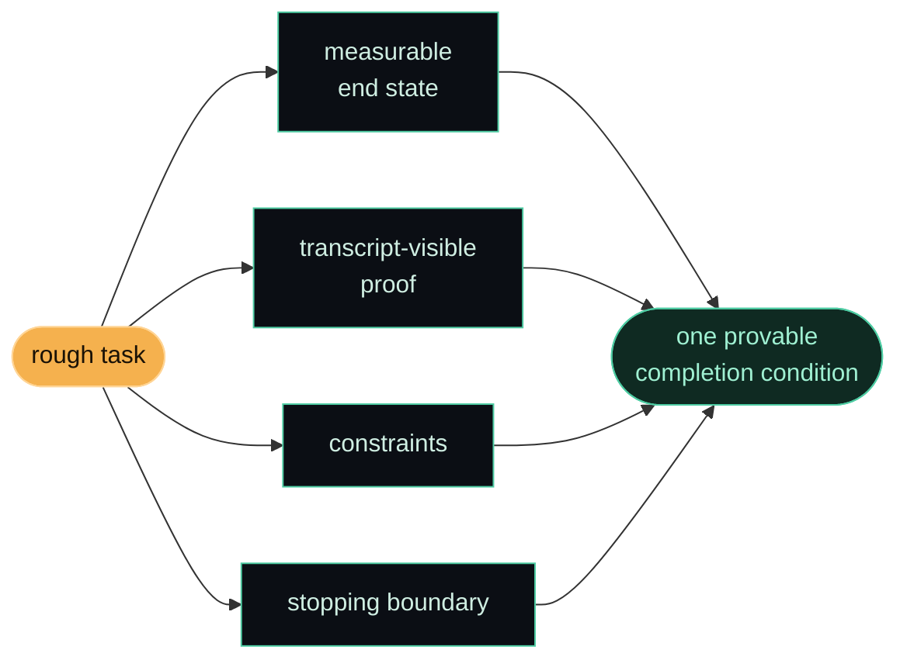

<p align="center">
  
</p>

<p align="center">
  <a href="https://github.com/edcadet10/write-goal/actions/workflows/ci.yml"></a>
  <a href="LICENSE"></a>
  <a href="https://code.claude.com/docs/en/skills"></a>
  <a href="https://learn.chatgpt.com/docs/build-skills"></a>
  
  
  <a href="CONTRIBUTING.md"></a>
</p>

<p align="center"><b>Turn a rough task into one measurable goal, with the evidence needed to prove it.</b><br>For Claude Code and Codex. No API key or third-party Python packages.</p>

---

## quick start

Install directly from GitHub through your host's plugin manager. Python is
needed only for the standalone installer below.

**Claude Code — in your terminal:**

```bash
claude plugin install write-goal --marketplace edcadet10/write-goal
```

Start a new Claude session, then invoke `/write-goal:write-goal <rough task>`.
See [Claude's plugin installation guide](https://code.claude.com/docs/en/plugins/install).

**Codex — in your terminal:**

```bash
codex plugin marketplace add edcadet10/write-goal
codex plugin add write-goal@write-goal
```

Start a new session and select the plugin's Write Goal skill. The catalog is
hosted in this repository; it is separate from a listing in the public plugin
directory. See [OpenAI's plugin documentation](https://developers.openai.com/plugins/build/plugins).
Native installation was tested with Claude Code 2.1.316 and Codex CLI 0.166.0.
Choose either plugin or standalone installation to avoid duplicate skill entries.

**Standalone skill — Python 3.10+ and Git:**

```bash
git clone https://github.com/edcadet10/write-goal.git
cd write-goal
python install.py --target claude
# Or install for Codex:
python install.py --target codex
```

Use `python3` if that is your Python command. The original `./install.sh`
entrypoint remains available and forwards the same options.

| Host | Invoke | Result |
| --- | --- | --- |
| Claude Code | `/write-goal <rough task>` | One `/goal <condition>` line |
| Codex | `$write-goal <rough task>` | One plain completion condition for the host's available goal tools |

These short invocation names apply to standalone installations. Claude plugin
skills use the `/write-goal:write-goal` namespace shown above.

For a manual installation without Python, download the skill-only ZIP from
[Releases](https://github.com/edcadet10/write-goal/releases/latest) and extract
its `write-goal/` folder into your host's skills directory listed below.

The skill drafts by default. It starts no loop, executes no checks, and
replaces no active goal unless you explicitly request activation. It does not
schedule future work or continue after a session ends.

## before and after

**Your request:** "Draft a goal: all 14 existing parser fixtures pass. Do not
modify production files. Stop after 9 turns. The verification command is
`python -m unittest discover -s tests/parser`."

**Codex draft:**

```text
All 14 existing parser fixtures pass, proven by the actual printed output and exit status 0 from `python -m unittest discover -s tests/parser`. Do not modify production files or weaken checks. After 9 turns, stop and report any unmet criteria without claiming achievement.
```

In Claude Code the same condition starts with `/goal `. If a check is unknown,
you get a visible `<verification command>` placeholder to replace before
activation. If the task has no concrete finish line, you get one question.

## how it came to life

I was poking at Claude Code's `/goal` command, trying to work out its switches, and somewhere in there it clicked that I'd been ignoring a whole built-in loop. `/goal <condition>` keeps Claude working across turns until the condition is true. I'd been babysitting long tasks by hand the entire time.

Then I hit the catch. Claude Code's evaluator can't run commands or open files independently. It judges evidence surfaced in the conversation. So "loop until the tests pass" needs actual test output, and "until the code is clean" needs a concrete definition. A good goal has to carry its own proof. See the [official /goal documentation](https://code.claude.com/docs/en/goal).

I didn't want to solve that puzzle by hand every time I started a loop. So I asked for a skill that writes the goal for me: give it a rough task, hand me back one line I can paste. That's `write-goal`. Funny enough, every task in the session where it was born was itself set with `/goal` — including the one that built this.

It's the second skill in my Claude Code arsenal, after [disconfirm](https://github.com/edcadet10/disconfirm).

## what it does

You run it with a rough task:

```text
/write-goal migrate the auth module to the new API
```

It hands back one condition (`/goal` in Claude Code) with four things built in:

- a measurable end state, a real signal like an exit code or a file count, never "works" or "done"
- a proof that shows up in the transcript, a specific command whose output Claude prints
- the constraints to hold, what must not change on the way there
- a stopping boundary: your turn cap, budget, or deadline, with 30 turns as the default when none is supplied

If your task is too vague to have a finish line, it asks you exactly one question and then gets on with it. One question, never a quiz.

## how it builds the goal



## install locations and updates

Claude defaults to `~/.claude/skills/` and respects `CLAUDE_CONFIG_DIR`.
Codex defaults to `~/.agents/skills/`, or `$CODEX_HOME/skills/` when set.
These are local installed copies; GitHub is the maintained source of truth.
See [OpenAI's skill documentation](https://learn.chatgpt.com/docs/build-skills)
for discovery and invocation. Newly installed Codex skills are available on
your next turn; restart if your host has not refreshed its list.

To choose a skills parent directory:

```bash
python install.py --target codex --dest "/path with spaces/skills"
```

An identical reinstall makes no changes. A different installed copy is
preserved unless you explicitly pass `--force`. Review local edits first;
`--force` replaces this skill's directory, including obsolete files, while
leaving neighboring skills alone.

```bash
git pull --ff-only
python install.py --target codex --force
```

Hosts may also select the skill when your request matches its description.
Claude's `/goal` command requires workspace trust and permitted hooks; drafting
a condition does not change host permissions. Codex does not use those
Claude-specific requirements.

## a real example

Rough task in:

```text
/write-goal split src/utils.js into modules under 200 lines; preserve exported signatures. The project defines npm run build and npm test.
```

`/goal` line out:

```text
/goal src/utils.js is split into modules each under 200 lines with all imports updated, proven by printed line counts and actual `npm run build` and `npm test` output with exit status 0. Do not change any exported function signature or weaken tests. After 30 turns, stop and report any unmet criteria without claiming achievement.
```

The size limit and commands came from the request. The draft preserves the
exports, asks for actual evidence, and stops with an honest status if the cap
is reached. It never invents a project command to make a goal look executable.

For external outcomes such as stars, sales, or approvals, the skill preserves
the target and deadline, names the authoritative metric, and distinguishes
work completed from an outcome it cannot guarantee. A deadline is not an
automatic scheduler, and reaching a time limit is not achievement.

## testing

```bash
python scripts/check.py
```

CI exercises real isolated installations on Windows, macOS, and Linux with
Python 3.10 and 3.12. Tests cover repeat installs, local edits, explicit updates,
rollback, paths with spaces, environment overrides, and destination boundaries.

Skill behavior is tested separately with fictional drafting requests. See the
[evaluation guide](evals/README.md) for the cases, response checker, and limits
of automated grading. Passing package tests is not proof of model behavior.

## the one rule it never breaks

The proof has to be actual observed evidence surfaced in the conversation.
A claim that a check passed is not enough. The draft must also preserve the
user's constraints, approval gates, and chosen host.

## contribute

Contributions are welcome. Read the [guide](CONTRIBUTING.md), open an [issue](https://github.com/edcadet10/write-goal/issues/new/choose), or discuss broad changes in [Discussions](https://github.com/edcadet10/write-goal/discussions). Run `python scripts/check.py` before opening a PR.

## part of my arsenal

Born in Claude Code and now available in Codex too. If it saves you from one
loop that ran twelve turns past done because the goal couldn't tell it was
finished, it earned its place. If it helps you, consider starring the repository
and sharing a fictional before-and-after example in an issue.

## license

MIT. Fork it, tighten it, make it yours. See [LICENSE](LICENSE).
